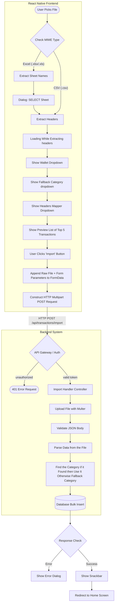

# Feature Plan: [Import Transactions]

## Feature Overview

- **Objective:** Allow users to import financial files (Excel/CSV) so they can bulk-add dozens of transactions to their profile instantly with a single upload.

## Architecture & Data Flow



---

## Data Contract Specifications

### Frontend Specifications (React Native / Expo)

**States**:

```ts
// Column Mapper Configuration (Stores column header names from the file)
export type ImportTransactionsHeadersMapper = {
  amount: string; // Required: e.g., "Price" or "Spent Amount"
  date: string; // Required: e.g., "Txn Date"
  title?: string; // Optional: e.g., "Transaction Title"
  description?: string; // Optional: e.g., "Notes"
  merchantName?: string; // Optional: e.g., "Payee / Vendor"
  type?: string; // Optional: e.g., "Transaction Type"
  category?: string;
};

// React Native Form State
export interface ImportTransactionsFormState {
  selectedFile: {
    uri: string;
    name: string;
    mimeType: string;
  } | null;
  sheetName?: string;
  walletId: string;
  fallbackCategoryId: string;
  mapper: ImportTransactionsHeadersMapper;
}
```

**Packages**:

1. **expo-document-picker:** Opens the Device's Native file picker so user can select Excel file.
2. **expo-file-system:** Reads the contents of the picked file from teh device storage.
3. **xlsx:** Parse the Excel and CSV file data into Javascript array/objects.

```
npx expo install expo-document-picker expo-file-system xlsx
```

---

### Network Layer Specifications

**Endpoint:**

```
/api/transactions/import
```

**Payload Structure:**

```json
{
  "file": "file://transactions.csv",
  "fileMimeType": "text/csv",
  // if mimeType is not Excel so sheetName will not be onluded in request Body
  // "sheetName": "Sheet 2",
  "walletId": "1jiaysd767as565",
  "fallbackCategoryId": "6haskhasdjgby766",
  "mapper": {
    "amount": "Price",
    "date": "Date",
    "title": "Title",
    "description": "Desc",
    "merchantName": "Vendor",
    "type": "Type",
    "categoy": "Transaction Category",
  }
}
```

- make sure to `stringify` the `mapper` in `multipart/form-data` object because `multipart/form-data` does not support nested objects

---

### Backend Specifications (Nodejs)

**States:**

```ts
// What arrives in req.body via Multer
export interface ImportTransactionRequestBody {
  walletId: string;
  fallbackCategoryId: string;
  sheetName?: string;
  mapper: string; // JSON string from FormData: Parse with JSON.parse(req.body.mapper)
}

// Parsed mapper object on backend
export interface ParsedHeadersMapper {
  amount: string;
  date: string;
  title?: string;
  description?: string;
  merchantName?: string;
  type?: string;
  category?: string;
}
```

**Packages:**

2. **xlsx:** Parse the Excel and CSV file data into Javascript arrays/objects
3. **multer:** Upload the file temporarily in the memory

---

## 5. Edge Cases & Validation

- **Invalid File Formats:** Reject non-CSV/Excel files on both frontend picker and backend multer filter.
- **Empty Files/Sheets:** Validate that `rawRows.length > 0` before attempting bulk insert.
- **Missing Required Mappings:** Ensure backend validates that `mapper.date` and `mapper.amount` are present in `req.body`.
- **Corrupted Row Data:**
  - If `amount` is not a valid number (`NaN`), skip the row or default to 0.
  - If `date` is invalid, fallback to current timestamp or skip.
- **Orphaned Categories:** If the row's category string doesn't match any user or default category in the database, successfully fallback to `fallbackCategoryId`.
- **Large Payload / File Size:** Enforce a strict file size limit (e.g., 5MB max) to prevent server lag or memory crashes.
- **Fallback fields value:**
  - `type (Income vs. Expense):`
	  - `If mapped:` Check the cell value (e.g., "CR", "Credit", "In", "Income" → income; "DR", "Debit", "Out", "Expense" → expense) and    make amount always positive (Math.abs(amount)).
	  - `If NOT mapped:` Infer type from the sign of amount (amount >= 0 ? 'income' : 'expense'), then store Math.abs(amount).

  - `title & merchantName:`
	  - Bank CSVs usually only have one text column (like Particulars or Narrative).
	  - Smart Fallback Rule: If the user maps description or merchantName but leaves title empty, automatically copy merchantName || description || "Imported Transaction" into title so your transaction cards in the UI never show a blank title.

  - `category:`
	  - `If mapped:` Look up the lowercase text in your Mongoose Category map; if not found, use fallbackCategoryId.
	  - `If NOT mapped:` Directly assign fallbackCategoryId.
