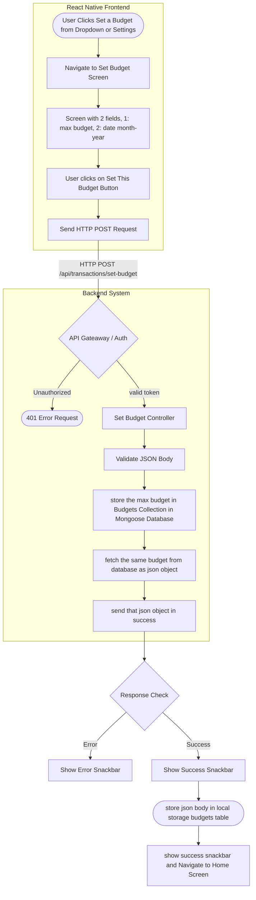

# Feature Plan: [Set Budget on Transactions]

## Feature Overview

* **Objective:** Allow users to set a max budget to spend on current month and alert the user if they exceeds that max budget.

---

## Architecture & Data Flow




## Data Contract Specifications

### Frontend Specifications (React Native / Expo)

**States:**

- set the current month-year value to monthYear state in init of SetBudget Screen


```ts

const [maxBudget, setMaxBudget] = useState<number>(0);
const [monthYear, SetMonthYear] = useState<string>("");


export interface SetBudgetRequestPayload {
    maxBudget: number;
    monthYear: string;
};


export interface Budget {
    id: string;
    maxBudget: number;
    monthYear: string;
    totalSpent: number;
    createdAt: Date;
};

export interface BudgetDTO {
    id: string;
    maxBudget: string;
    monthYear: string;
    totalSpent: string;
    createdAt: string;
};
```

---

## Network Layer Specifications

**Endpoint:**
```
/api/set-budget
```

**Payload Structure:**
```json
{
    "maxBudget": 12000, // in base currency
    "monthYear": "09-2026"
}
```