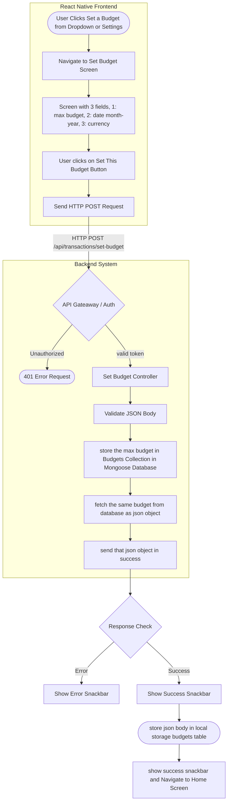

# Feature Plan: [Set Budget on Transactions]

## Feature Overview

* **Objective:** Allow users to set a max budget to spend on current month and alert the user if they exceeds that max budget.

---

## Architecture & Data Flow




## Data Contract Specifications

### Frontend Specifications (React Native / Expo)

**States:**

- set the current year-month value to month state in init of SetBudget Screen
- for now currency field's value will be baseCurrency of user


```ts

const [maxBudget, setMaxBudget] = useState<number>(0);
const [month, SetMonth] = useState<string>("");


export interface SetBudgetRequestPayload {
    maxBudget: number;
    month: string;
    currency: string;
};


export interface Budget {
    id: string;
    maxBudget: number;
    currency: CurrencyCode; // CurrencyCode is type of currencies
    month: string;
    totalSpent: number;
    createdAt: Date;
};

export interface BudgetDTO {
    id: string;
    maxBudget: string;
    currency: string;
    month: string;
    totalSpent: string;
    createdAt: string;
};
```

---

## Network Layer Specifications

**Endpoint:**
```
/api/set-budget
```

**Payload Structure:**
```json
{
    "maxBudget": 12000, // in base currency
    "month": "2026-09",
    "currency": "pkr"
}
```

---

## Backend Specifications

- before creating budget, check if the budget for the month user entered is exists then update the maxBudget and if not so create Budget.
- while creating transaction fetch the budget match with transaction date and convert the transaction amount's `currency` to amount of budget `currency` and `increase` the `totalSpent`

**States:**
```ts
export interface SetBudgetRequestPayload {
    maxBudget: number;
    month: string;
    currency: string;
};


export interface IBudget extends Document {
    userId: Types.ObjectId;
    maxBudget: number;
    currency: string;
    month: string;
    totalSpent: number;
    createdAt: Date;
}
```


---

## Edge Cases & Validation

- make sure user input Max Budget in base currency so show the base currency in input.
- maxBudget must be `greater` than `0` and `less` than or `equal` to `999,999,999.99` (or `1,000,000,000`).
- user cannot set maxBudget for the `past months`.
- prevent the duplicate maxBudget of the same month and if it exists then let user update it.
- alert user if try to create transaction that exceeds the current month maxBudget (alert can be simple error text below the amount field or dialog or bottom sheet).
    - make sure to check the maxBudget month with the transaction date instead of calender's date month while creating transaction.
